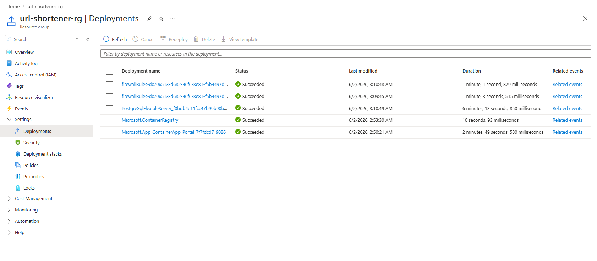
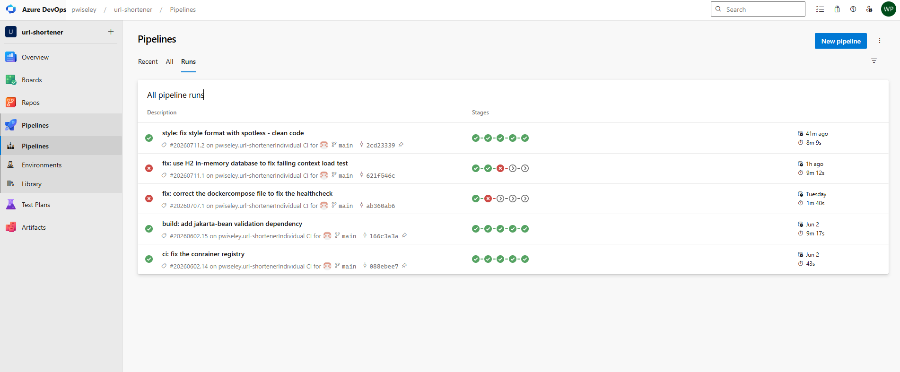
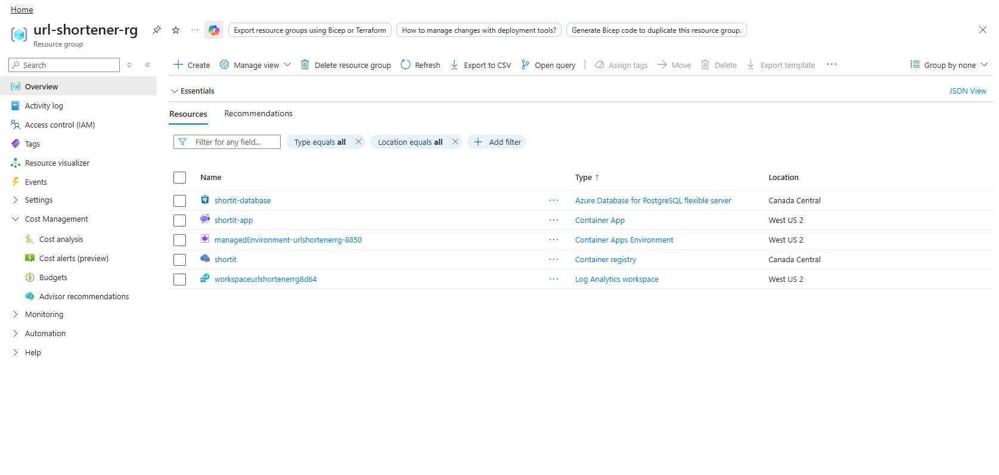

# URL Shortener

[Read in English](README.md)

Service full-stack de raccourcissement d'URL, avec statistiques de clics et gestion des redirections.

> [Démo en ligne](https://go.petiton.dev)

## Sommaire

- [Technologies](#technologies)
- [Pipeline CI/CD](#pipeline-cicd)
- [API](#api)
- [Déploiement](#déploiement)
- [Projets connexes](#projets-connexes)

## Technologies

| Couche | Technologie |
|---|---|
| **Backend** | Java 21, Spring Boot 3, Maven |
| **Frontend** | Angular, TypeScript |
| **Base de données** | PostgreSQL |
| **CI/CD** | Azure DevOps Pipelines |
| **Hébergement** | Azure Container Apps, Azure Container Registry |
| **Architecture** | Controller / Service / Repository |

## Pipeline CI/CD

Chaque push sur `main` déclenche un pipeline en cinq étapes. Rien n'arrive en production sans avoir passé les vérifications de style, d'analyse statique, de dépendances et de vulnérabilités de l'image.

| Étape | Rôle |
|---|---|
| **Build** | Compile et package le backend avec **Maven** |
| **Test** | Exécute les tests unitaires et publie les résultats **JUnit** |
| **Qualité et sécurité** | Trois vérifications en parallèle : style de code avec **Spotless**, qualité et couverture avec **SonarCloud**, vulnérabilités des dépendances avec **OWASP Dependency-Check** |
| **Push** | Construit l'image, la pousse sur **Azure Container Registry** et l'analyse avec **Trivy** |
| **Deploy** | Déploie la nouvelle image sur **Azure Container Apps** |

## API

> [Documentation de l'API (Swagger)](https://go.petiton.dev/swagger-ui/index.html)

| Méthode | Route | Rôle |
|---|---|---|
| `POST` | `/api/urls` | Créer une URL courte à partir d'une URL longue |
| `GET` | `/{shortCode}` | Résoudre un code court et rediriger (`302 Found`) |

Raccourcir une URL :

```jsonc
// POST /api/urls
{ "originalUrl": "https://www.example.com/some/very/long/path?ref=newsletter" }

// 201 Created
{
  "shortCode": "a1B2c3",
  "originalUrl": "https://www.example.com/some/very/long/path?ref=newsletter",
  "shortUrl": "https://go.petiton.dev/a1B2c3"
}
```

Une URL invalide retourne `400 Bad Request` avec un message de validation par champ.

## Déploiement

Les images sont construites par le pipeline **Azure DevOps**, stockées dans **Azure Container Registry** et déployées sur **Azure Container Apps**.







## Projets connexes

- [insurance-quote](https://github.com/pwiseley/insurance-quote) : Spring Boot + React, en ligne sur `primio.petiton.dev`
- [vehicle-maintenance-tracker](https://github.com/pwiseley/vehicle-maintenance-tracker) : C# / ASP.NET Core + React, en ligne sur `vmt.petiton.dev`
- [Floppa Marketplace](https://github.com/pwiseley/Floppa-app) : API REST Java, architecture en trois couches, CI/CD
- [Portfolio](https://petiton.dev)
